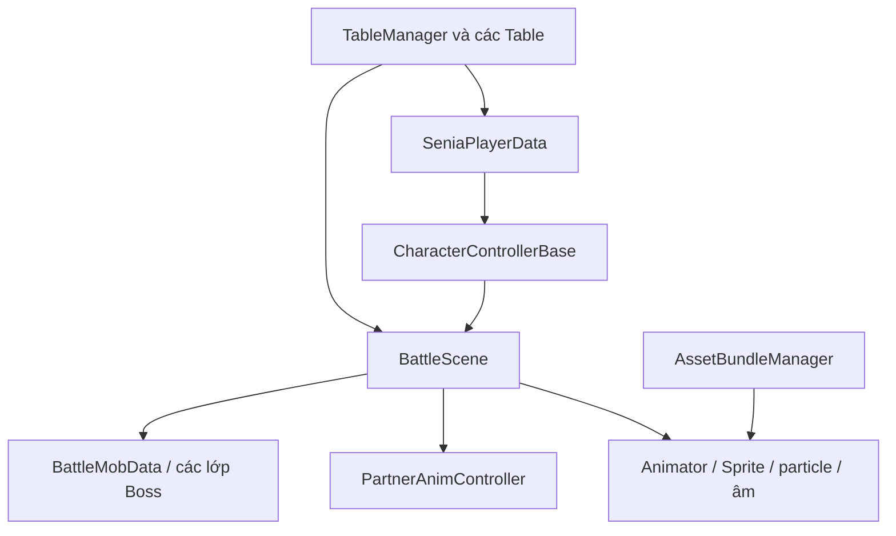

# Kiến trúc tham khảo

Đây là sơ đồ diễn giải từ tên lớp, trường và tham chiếu; không phải call graph
đã xác minh bằng runtime. Tên gốc chỉ dùng tra cứu trong catalogs/core_class_map.json.

## Vòng chơi và chiến đấu
BattleScene có các state/coroutine được đặt tên: preload tài nguyên, bắt đầu,
chuyển vị trí/khu, tap attack, skill, đồng hành, quái chết, hội thoại, thưởng.
Có WaitAnimEvent/WaitAnimDelayHit và đường nhận sự kiện nhân vật/quái. Đây là
bằng chứng cơ chế điều phối theo trạng thái và mốc, không phải vòng trừHP duy nhất.

CharacterControllerBase có cập nhật atk/cri/weapon/partner buff, lựa chọn tap
combo1/2/3, phát skill1–4 và xử lýHP/TP. Chưa khẳng định thứ tự nhân buff hoặc
công thức crit chỉ từ tên hàm. PartnerAnimController có Attack/Run/Moveout và
OnAnimAtk/OnAnimAtkMultiple/OnAnimAtkEnd/particle/sound.

Boss có nhiều lớp chuyên biệt, gồm Counter/Shield/Smash. Đây là gợi ý thiết kế
các chiến thuật boss riêng; không có nghĩa đã biết chính xác điều kiện counter.

## Dữ liệu người chơi
SeniaPlayerData chứa dữ liệu nhân vật, đồng hành, đồ cóUID, vật phẩm, khu vực,
nhiệm vụ/cờ hướng dẫn, mốc offline. Đây là schema class, không đọc giá trị tài
khoản trong game.sav. Không đưa IsCheater/SDK/hệ quảng cáo vào thiết kế mới chỉ
vì thấy chúng trong dump.

## Bài học thiết kế
- Tách catalogue bất biến khỏi tiến trình người chơi và trạng thái trận tạm.
- Tải tài nguyên ngoài vòng tính sát thương; có preload và unload.
- Timeline phát hình/âm/particle; damage do mô hình trận sở hữu và chống phát đôi.
- UI gửi command, model kiểm điều kiện và commit; UI chỉ hiển thị kết quả đã lưu.
- Chỉ lưuUID và tiến trình cần thiết, không serialize tham chiếu node/UI.

## Khác biệt với dự án Kiếm Hành hiện có
Cấu trúc gốc có main character, tap combo và assist/partner; không được mô tả
nó là đội5auto giống hệt Kiếm Hành. Có thể tham khảo pipeline tài nguyên và
cấu trúc dữ liệu mà giữ chiến đấu đội5, hoặc xây dự án main hero+assist mới.
Chọn một hướng rõ ràng trước khi đổi gameplay đã có.
